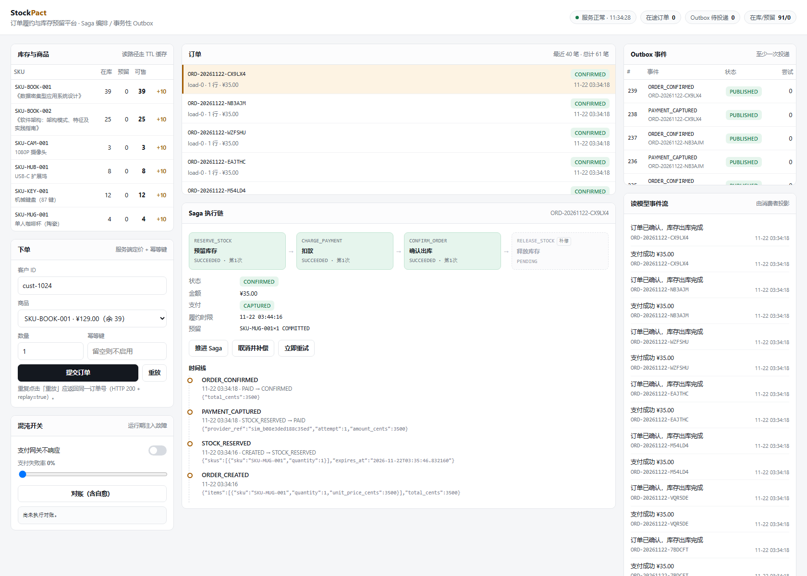

# StockPact · 订单履约与库存预留平台

> 一个能真跑起来的履约中台切片：**Saga 编排 + 库存预留 TTL + 事务性 Outbox + 幂等下单**。
> 不做 CRUD 演示，而是把"钱扣了库存没减""库存占了没人释放""消息重复投递""进程崩溃卡在半路"这四类真实故障，
> 各自对应成一条可观测、可演练、可自愈的工程机制。



---

## 1. 它解决什么问题

一次下单在分布式系统里会被拆成三段：**占库存 → 扣款 → 出库确认**。任何一段失败或超时，都会留下不一致：

| 真实故障 | 朴素的写法 | StockPact 的做法 |
| --- | --- | --- |
| 两个人同时抢最后一件 | 先查库存再更新 → 超卖 | 条件更新 `WHERE on_hand - reserved >= qty`，把判据交给数据库 |
| 扣款成功但出库失败 | 订单卡在"已支付" | Saga 步骤表 + 补偿（退款 + 释放预留） |
| 库存占了，用户不付款也不取消 | 库存被永久占住 | 预留 TTL + 回收器主动补偿 |
| 扣款接口超时 | 当成失败，重复下单重复扣 | 超时视为"未确认"，固定幂等键重试，`payments.order_id` 唯一约束兜底 |
| 订单改了但事件丢了 / 事件重复投递 | 双写、消费不幂等 | 事务性 Outbox + `processed_events` 消费去重 |
| 执行器推进到一半进程被杀 | 订单永远停在中间态 | 租约（lease）+ 过期抢占 + 恢复器接管 |
| 没人知道系统现在到底一致不一致 | 靠人查表 | `/api/ops/reconcile` 结构化对账 + Prometheus 指标 |

## 2. 架构

```
                    ┌──────────────────────────────────────────────┐
  浏览器 / 调用方 ──▶ │  API 层 (FastAPI)                             │
                    │  幂等下单 · 限流 · 请求ID · 访问日志 · 指标中间件  │
                    └───────────────┬──────────────────────────────┘
                                    │  只做协议转换，不写业务判断
                    ┌───────────────▼──────────────────────────────┐
                    │  应用服务层                                    │
                    │  OrderService   CatalogService   RecoveryService│
                    └───────┬───────────────────────┬──────────────┘
                            │                       │
                 ┌──────────▼─────────┐   ┌─────────▼──────────────┐
                 │  SagaOrchestrator  │   │  OutboxRelay           │
                 │  租约领取/步骤推进/补偿 │   │  轮询投递 + 消费幂等     │
                 └───┬────────────┬───┘   └─────────┬──────────────┘
                     │            │                 │
          ┌──────────▼──┐  ┌──────▼───────┐  ┌──────▼─────────────┐
          │ Inventory   │  │ Payment      │  │ Consumers          │
          │ 条件更新预留  │  │ 模拟网关+混沌 │  │ read_model/notifier│
          └─────────────┘  └──────────────┘  └────────────────────┘
                     │            │                 │
                    ┌▼────────────▼─────────────────▼────────────┐
                    │ 仓储层 (SQLAlchemy)  orders/order_items/...  │
                    │ 事务边界显式 · 锁冲突统一重试                  │
                    └────────────────────────────────────────────┘
```

分层规则只有一条：**路由层不写业务判断，领域层不碰数据库，仓储层不表达业务意图**。
`domain/order.py` 是纯 Python（状态机 + 不变量），可以脱离框架做单元测试；`services/*` 组合仓储表达用例；
`api/*` 只做协议转换。

### 订单状态机

```
CREATED ──预留成功──▶ STOCK_RESERVED ──扣款成功──▶ PAID ──出库──▶ CONFIRMED
   │                       │                      │
   └──── 缺货/超时 ────────┴──── 支付失败/超时 ────┴── 退款 + 释放 ──▶ CANCELLED
```

迁移白名单写在 `ALLOWED_TRANSITIONS`，非法迁移直接 409（例如试图跳过扣款直接确认）。

### Saga 步骤

| 步骤 | 类型 | 幂等保证 |
| --- | --- | --- |
| `RESERVE_STOCK` | 正向 | `reservations(order_id, sku)` 唯一 + 条件更新 |
| `CHARGE_PAYMENT` | 正向（外部 I/O） | `payments.order_id` 唯一 + 确定性 `provider_ref` |
| `CONFIRM_ORDER` | 正向 | 只对 `HELD` 预留出库，重复执行无副作用 |
| `RELEASE_STOCK` | 补偿 | 只释放 `HELD`、只对 `CAPTURED` 退款 |

---

## 3. 关键设计取舍

| 决策 | 选择 | 原因 / 代价 |
| --- | --- | --- |
| 编排 vs 协同 | **编排式 Saga** | 只有 3 个参与方，但补偿顺序与"卡住谁接管"必须显式可控。代价是编排器成为核心组件 |
| 分布式事务 | **不用 2PC**，用 Saga + 幂等 | 2PC 会长时间持锁且依赖协调者；业务上"允许短暂不一致，最终一致"即可 |
| 事件发布 | **事务性 Outbox** | 状态与事件同事务，杜绝双写丢事件；代价是多一张表和一次轮询 |
| 投递语义 | **至少一次 + 消费幂等** | 比"恰好一次"更可实现；用 `processed_events(consumer,event_id)` 主键去重 |
| 并发控制 | **条件 UPDATE + 租约** | 不依赖 `SELECT FOR UPDATE`，SQLite/Postgres 语义一致；锁冲突在仓储层统一重试 |
| 时间语义 | **预留 TTL 而非永久占用** | 库存是稀缺资源，超时回收比"等用户取消"更符合业务 |
| 支付结果不确定 | **未确认 ≠ 失败** | 超时进入退避重试，绝不当成成功；重试耗尽才补偿 |
| 缓存 | **进程内 TTL + 主动失效** | 单实例够用且零依赖；多实例必须换共享缓存，已在局限中标注 |

完整的 ADR 记录见 [`docs/decisions.md`](docs/decisions.md)。

---

## 4. 快速开始

### 本地运行（Python 3.11+）

```bash
python -m venv .venv
# Windows: .venv\Scripts\activate    macOS/Linux: source .venv/bin/activate
pip install -r requirements-dev.txt
pip install --no-deps -e .

python scripts/seed.py --reset        # 建 6 个 SKU + 期初库存
uvicorn stockpact.main:create_app --factory --host 127.0.0.1 --port 8080
```

打开 <http://127.0.0.1:8080/> 是控制台，<http://127.0.0.1:8080/docs> 是 OpenAPI 文档。

### Docker

```bash
docker compose up --build
# 或
docker build -t stockpact:1.0.0 . && docker run -p 8080:8080 -v stockpact-data:/data stockpact:1.0.0
```

> 说明：本机没有 Docker 环境，`docker-compose.yml` 只做了 YAML 结构校验（services/volumes/healthcheck），
> **未实际构建镜像**。本地运行路径是完整验证过的。

### 一分钟验证

```bash
# 下单（服务端定价，客户端传的价格会被忽略）
curl -s -X POST http://127.0.0.1:8080/api/orders \
  -H 'Content-Type: application/json' -H 'Idempotency-Key: demo-1' \
  -d '{"customer_id":"cust-1","items":[{"sku":"SKU-BOOK-001","quantity":2}]}'

# 用同一个 key 再发一次：返回同一订单号，replayed=true，数据库里只有一张单
curl -s -X POST http://127.0.0.1:8080/api/orders \
  -H 'Content-Type: application/json' -H 'Idempotency-Key: demo-1' \
  -d '{"customer_id":"cust-1","items":[{"sku":"SKU-BOOK-001","quantity":2}]}'

# 注入故障：支付 100% 失败
curl -s -X PUT http://127.0.0.1:8080/api/ops/chaos \
  -H 'Content-Type: application/json' -d '{"payment_failure_rate":1.0}'
```

---

## 5. API 一览

| 方法 | 路径 | 说明 |
| --- | --- | --- |
| POST | `/api/orders` | 下单，支持 `Idempotency-Key`；重放返回 200 + `X-Idempotent-Replay: true` |
| GET | `/api/orders?state=&limit=&offset=` | 订单列表（分页 + 状态过滤） |
| GET | `/api/orders/{code}` | 订单详情：时间线、Saga 步骤、支付、预留 |
| POST | `/api/orders/{code}/cancel` | 取消并补偿（已支付会退款） |
| POST | `/api/orders/{code}/advance` | 手动推进一次 Saga（演练/排障） |
| POST | `/api/orders/{code}/retry` | 跳过退避立即重试 |
| GET/POST | `/api/catalog/products` | 商品与库存快照 / 建档（管理端） |
| GET | `/api/inventory` `/api/inventory/{sku}` | 库存（读路径走 TTL 缓存） |
| POST | `/api/inventory/{sku}/restock` | 补货（管理端） |
| GET/PUT | `/api/ops/chaos` | 查看/调整故障注入开关 |
| GET | `/api/ops/outbox` | Outbox 事件与积压 |
| GET | `/api/ops/feed` | 读模型投影、通知、库存流水 |
| GET | `/api/ops/audit` | 审计日志（含 request_id） |
| GET | `/api/ops/sagas` | Saga 运行态概览 |
| GET | `/api/ops/reconcile?repair=` | 对账（可选先自愈） |
| GET | `/metrics` `/healthz` `/readyz` | Prometheus 指标 / 存活 / 就绪 |

完整请求响应示例、错误码表见 [`docs/api.md`](docs/api.md)。

---

## 6. 测试与验证结果

以下数字来自本机（Windows 11 / Python 3.12.10 / SQLite WAL）真实执行，不是估计值。

### 单元 + 集成 + 并发测试

```
$ pytest
47 passed in 6.4s
```

覆盖的关键行为：

- **不超卖**：库存 3，24 线程并发抢 1 件 → 恰好 3 次成功，`available` 不为负
- **整单原子**：多 SKU 中任一不足 → 全部预留回滚（不留半成品）
- **并发推进**：10 个执行器同时推进同一订单 → 只有 1 条支付记录、1 条 `PAYMENT_CAPTURED`
- **幂等下单**：8 个并发请求同一 `Idempotency-Key` → 只有 1 张订单
- **补偿**：缺货 / 支付失败 / 支付超时 / 超时未支付 / 用户取消（含已支付退款）5 条路径
- **Outbox**：投递、重复投递不二次投影、毒丸消费者只影响单个事件
- **恢复**：租约过期的 `RUNNING` 步骤被接管；TTL 到期预留被回收
- **API 契约**：201/200/401/404/409/422/429 状态码与错误体、限流 `Retry-After`、指标文本格式

### 故障演练（真实服务进程，`scripts/chaos_drill.py`）

```
场景 A 正常履约        CONFIRMED / CAPTURED / 在库 40 → 39
场景 B 支付 100% 拒绝  重试 3 次后 CANCELLED(PAYMENT_FAILED)，库存 39 → 39（已回滚）
场景 C 网关不响应      记录"超时"，重试耗尽后补偿，库存归还
场景 D 库存被抢空      超额订单 CANCELLED(OUT_OF_STOCK)，available=0 不为负

15 项通过，0 项失败
```

### 并发压测（`scripts/load_test.py --orders 120 --workers 16`）

```
请求数=112  吞吐=21.6 req/s
延迟 p50=48.7ms  p95=1098.8ms  p99=1958.9ms
112 单全部 CONFIRMED，在途=0，Outbox 积压=0，收敛耗时 4.9s
库存 260 → 148（出库 112），预留=0
对账 healthy=True，无死信
```

### 容量与瓶颈分析（重要）

单条下单链路约 **7 次事务提交**（建档幂等记录、租约、预留、支付、确认、事件），在 SQLite 单写者模型下，
提交即串行：串行请求 p50 ≈ 48ms，16 并发时 p95 升到 ~1.1s，吞吐被压在 ~22 单/s。

这不是 Saga 的问题，而是**存储层写吞吐**的问题。要提升有几个明确方向（按性价比排序）：

1. 换 PostgreSQL：行级锁 + 并发提交，写吞吐提升数量级（本项目未实测，代码层已避免 SQLite 专属语法）；
2. 把 Outbox 中继与恢复器拆成独立进程（`STOCKPACT_BACKGROUND=0`），API 只做写路径；
3. 减少每单事务数：DB-only 步骤（预留/确认）把"领取租约 + 执行 + 记账"合并到一个事务；
4. Outbox 投递支持批量事务（代价是牺牲单事件隔离粒度）。

---

## 7. 目录结构

```
stockpact/
├── src/stockpact/
│   ├── domain/        # 状态机、不变量、领域错误（纯 Python，无框架依赖）
│   ├── infra/         # 数据库、表结构、仓储、缓存、限流
│   ├── services/      # 订单/库存/支付/Saga/Outbox/恢复/对账/混沌
│   ├── api/           # 路由、契约模型、中间件
│   ├── obs/           # 结构化日志、Prometheus 指标
│   ├── web/           # 控制台单页（原生 JS，无构建）
│   ├── container.py   # 组合根
│   └── main.py        # 应用工厂 + 生命周期
├── tests/             # 47 个用例（领域/并发/幂等/Saga/Outbox/恢复/API）
├── scripts/           # seed / load_test / chaos_drill
├── docs/              # architecture / api / decisions
├── Dockerfile · docker-compose.yml
└── var/               # 运行时数据（gitignore）
```

---

## 8. 已知局限（明确写出来，而不是藏着）

1. **单实例假设**：缓存、限流桶、后台循环都在进程内。多实例部署需要 Redis（桶与缓存）与独立 worker（中继/恢复）。
2. **存储只验证过 SQLite**：代码未使用 SQLite 专属语法，但 Postgres 路径未实测。
3. **支付是模拟网关**：`payment_stall` 模拟"不返回结果"，真实系统还需要"查询接口对账"来收敛未知状态。
4. **没有鉴权体系**：只有管理端 `X-API-Key` 粗粒度校验，客户身份来自请求体（生产应来自令牌）。
5. **对账是只读 + 有限自愈**：能发现并修复 TTL/重试类问题，不做跨库数据修复。
6. **Docker 未实机构建**：本机无 Docker。

## 9. 下一步

- [ ] 接入真实消息中间件（Kafka/RabbitMQ）替代轮询中继，同时保留 Outbox 作为可靠投递源
- [ ] 多实例：Redis 限流与缓存、独立 worker、基于 `FOR UPDATE SKIP LOCKED` 的批量领取
- [ ] 退货/换货子流程（正向 Saga 的第二条链路）
- [ ] 对账报表落库 + 定时任务 + 告警规则
- [ ] OpenTelemetry 链路追踪（当前只有 request_id 贯穿日志与审计）

---

## License

MIT
